# Findings

<!-- Generated by tools/catalog.py from docs/collection.json and catalog/findings.json. Do not edit by hand. -->

26 findings: 23 new-result candidates, 1 new proof of a known theorem and 2 independent verification notes. Every finding has a paper and a narrated video.

> These are research drafts. None has been externally peer reviewed. Novelty is judged against recorded literature searches, which cannot establish priority. Each entry states what is proved, how it was checked and what remains open.

| Finding | Field | Status | Paper | Video |
|---|---|---|---|---|
| [Common quartets in evolutionary trees](#common-quartets-in-evolutionary-trees) | Mathematics | New-result candidate | [PDF](public-release/papers/common-quartet-number.pdf) | [MP4](maths/combinatorics/phylogenetics/common-quartet-number/video/video.mp4) |
| [Rigidity of the 92 Johnson solids](#rigidity-of-the-92-johnson-solids) | Mathematics | New-result candidate | [PDF](public-release/papers/johnson-solids.pdf) | [MP4](maths/geometry/rigidity/johnson-solids/video/video.mp4) |
| [A finite covering-system obstruction](#a-finite-covering-system-obstruction) | Mathematics | New-result candidate | [PDF](public-release/papers/min-modulus-six-odd-part-45.pdf) | [MP4](maths/number-theory/covering-systems/min-modulus-six-odd-part-45/video/video.mp4) |
| [Winning permutation races by rotation](#winning-permutation-races-by-rotation) | Mathematics | New-result candidate | [PDF](public-release/papers/rotation-wins-penney.pdf) | [MP4](maths/probability/competing-patterns/rotation-wins-penney/video/video.mp4) |
| [Why integer tree-balance weights fail](#why-integer-tree-balance-weights-fail) | Mathematics | New-result candidate | [PDF](public-release/papers/colless-like-integer-weights.pdf) | [MP4](maths/combinatorics/phylogenetics/colless-like-integer-weights/video/video.mp4) |
| [Periodic symplectic billiards in special octagons](#periodic-symplectic-billiards-in-special-octagons) | Mathematics | New-result candidate | [PDF](public-release/papers/special-octagon-symplectic-billiards.pdf) | [MP4](maths/dynamical-systems/billiards/special-octagon-symplectic-billiards/video/video.mp4) |
| [Infinite words avoiding Cartesian-tree squares](#infinite-words-avoiding-cartesian-tree-squares) | Mathematics | New-result candidate | [PDF](public-release/papers/cartesian-tree-square-free-words.pdf) | [MP4](maths/combinatorics/combinatorics-on-words/cartesian-tree-square-free-words/video/video.mp4) |
| [Reduced graphs with four negative eigenvalues](#reduced-graphs-with-four-negative-eigenvalues) | Mathematics | New-result candidate | [PDF](public-release/papers/four-negative-eigenvalues.pdf) | [MP4](maths/combinatorics/spectral-graph-theory/four-negative-eigenvalues/video/video.mp4) |
| [How cheaply can the first player win Hex?](#how-cheaply-can-the-first-player-win-hex) | Mathematics | New-result candidate | [PDF](public-release/papers/hex-short-wins.pdf) | [MP4](maths/combinatorics/combinatorial-games/hex-short-wins/video/video.mp4) |
| [Bridge and meridional rank of thirteen-crossing knots](#bridge-and-meridional-rank-of-thirteen-crossing-knots) | Mathematics | New-result candidate | [PDF](public-release/papers/bridge-thirteen-crossing-census.pdf) | [MP4](maths/topology/knot-theory/bridge-thirteen-crossing-census/video/video.mp4) |
| [Bilinear complexity over small finite fields](#bilinear-complexity-over-small-finite-fields) | Mathematics | New-result candidate | [PDF](public-release/papers/mu-q-2-2.pdf) | [MP4](maths/algebra/bilinear-complexity/mu-q-2-2/video/video.mp4) |
| [An eleven-neuron stable nonclique network](#an-eleven-neuron-stable-nonclique-network) | Mathematics | New-result candidate | [PDF](public-release/papers/standard-parameter-counterexamples.pdf) | [MP4](maths/dynamical-systems/threshold-linear-networks/standard-parameter-counterexamples/video/video.mp4) |
| [Certified rings around marked tiles](#certified-rings-around-marked-tiles) | Mathematics | New-result candidate | [PDF](public-release/papers/marked-polyform-heesch-numbers.pdf) | [MP4](maths/geometry/tilings/marked-polyform-heesch-numbers/video/video.mp4) |
| [A shorter certificate for seven-cube tic-tac-toe](#a-shorter-certificate-for-seven-cube-tic-tac-toe) | Mathematics | New proof of a known theorem, with a correction | [PDF](public-release/papers/cubic-tic-tac-toe-surplus.pdf) | [MP4](maths/combinatorics/combinatorial-games/cubic-tic-tac-toe-surplus/video/video.mp4) |
| [Counting staircase Latin tableaux](#counting-staircase-latin-tableaux) | Mathematics | Independent verification; no priority claim | [PDF](public-release/papers/latin-tableaux-staircase-count.pdf) | [MP4](maths/combinatorics/latin-squares/latin-tableaux-staircase-count/video/video.mp4) |
| [Prime-successor Hales-Jewett numbers](#prime-successor-hales-jewett-numbers) | Mathematics | New-result candidate | [PDF](public-release/papers/prime-successor-hales-jewett.pdf) | [MP4](maths/combinatorics/ramsey-theory/prime-successor-hales-jewett/video/video.mp4) |
| [Local rigidity of the truncated dodecahedron](#local-rigidity-of-the-truncated-dodecahedron) | Mathematics | New-result candidate | [PDF](public-release/papers/truncated-dodecahedron.pdf) | [MP4](maths/geometry/rigidity/truncated-dodecahedron/video/video.mp4) |
| [Reconstructing generic Lotka-Volterra trees](#reconstructing-generic-lotka-volterra-trees) | Mathematics | Independent verification; no priority claim | [PDF](public-release/papers/tree-equivalence.pdf) | [MP4](maths/dynamical-systems/lotka-volterra/tree-equivalence/video/video.mp4) |
| [Distance-three qudit stabilizer codes](#distance-three-qudit-stabilizer-codes) | Physics | New-result candidate | [PDF](public-release/papers/distance-three-qudit-codes.pdf) | [MP4](physics/quantum-information/error-correction/distance-three-qudit-codes/video/video.mp4) |
| [Response bounds on cactus networks](#response-bounds-on-cactus-networks) | Physics | New-result candidate | [PDF](public-release/papers/cactus-response-coupling.pdf) | [MP4](physics/statistical-physics/nonequilibrium-response/cactus-response-coupling/video/video.mp4) |
| [Generic three-dimensional stiffness recovery](#generic-three-dimensional-stiffness-recovery) | Physics | New-result candidate | [PDF](public-release/papers/generic-stiffness-recovery.pdf) | [MP4](physics/mechanics/elasticity/generic-stiffness-recovery/video/video.mp4) |
| [A periodic waiting-time entropy counterexample](#a-periodic-waiting-time-entropy-counterexample) | Physics | New-result candidate | [PDF](public-release/papers/periodic-waiting-time.pdf) | [MP4](physics/statistical-physics/thermodynamic-inference/periodic-waiting-time/video/video.mp4) |
| [Global optimality of conjugate restart laws](#global-optimality-of-conjugate-restart-laws) | Physics | New-result candidate | [PDF](public-release/papers/conjugate-restart.pdf) | [MP4](physics/statistical-physics/stochastic-resetting/conjugate-restart/video/video.mp4) |
| [Chemical robustness with multiple stable states](#chemical-robustness-with-multiple-stable-states) | Chemistry | New-result candidate | [PDF](public-release/papers/acr-multistability-bounds.pdf) | [MP4](chemistry/reaction-networks/mass-action/acr-multistability-bounds/video/video.mp4) |
| [Sharp equilibrium counts from cubic sources](#sharp-equilibrium-counts-from-cubic-sources) | Chemistry | New-result candidate | [PDF](public-release/papers/cubic-equilibrium-sharpness.pdf) | [MP4](chemistry/reaction-networks/mass-action/cubic-equilibrium-sharpness/video/video.mp4) |
| [Exact resistance to three-team tournament manipulation](#exact-resistance-to-three-team-tournament-manipulation) | Economics | New-result candidate | [PDF](public-release/papers/three-team-manipulation-exact.pdf) | [MP4](economics/social-choice/tournament-rules/three-team-manipulation-exact/video/video.mp4) |

## Mathematics

### Common quartets in evolutionary trees

**New-result candidate** · Combinatorics / Phylogenetics

Evolutionary trees can be compared by how they arrange every group of four species. Any three fully resolved (binary) unrooted trees on 14 species must arrange some group of four identically, and 13 species are not enough. For any number of trees, the proven upper bound drops from a tower of four exponentials to a single exponential.

- **Result.** h(3)=14; a single-exponential general upper bound with base (1+sqrt(13))/2; 23<=h(4)<=28.
- **Boundary.** Lean checks only the sharp potential inequality and equality witness. Global optimality and h(4) remain open.
- **Paper:** [PDF](public-release/papers/common-quartet-number.pdf) · [LaTeX](maths/combinatorics/phylogenetics/common-quartet-number/paper.tex)
- **Video:** [MP4](maths/combinatorics/phylogenetics/common-quartet-number/video/video.mp4) · [Subtitles](maths/combinatorics/phylogenetics/common-quartet-number/video/subtitles.srt) · [Script and QA](maths/combinatorics/phylogenetics/common-quartet-number/video/README.md)
- **Checks:** [Verification](maths/combinatorics/phylogenetics/common-quartet-number/verification/README.md) · [Review state](maths/combinatorics/phylogenetics/common-quartet-number/readiness.md)
- **Formal:** [CommonQuartetPotential.lean](formal/ValyuResearch/CommonQuartetPotential.lean) (sharp potential inequality and equality witness only). See [formal coverage](docs/formal-coverage.md).
- **Package:** [maths/combinatorics/phylogenetics/common-quartet-number](maths/combinatorics/phylogenetics/common-quartet-number/)

### Rigidity of the 92 Johnson solids

**New-result candidate** · Geometry / Rigidity

The 92 Johnson solids are the convex solids with regular polygon faces that are not Platonic, Archimedean, prisms or antiprisms. If every edge keeps its length and every face stays flat, which of them can still flex? All 92 are classified: 47 are locally rigid and 45 flex.

- **Result.** 47 locally rigid and 45 flexible under fixed edge lengths and planar faces.
- **Boundary.** Local rigidity in the stated model, not rigidity of the bare edge graph or global uniqueness.
- **Paper:** [PDF](public-release/papers/johnson-solids.pdf) · [LaTeX](maths/geometry/rigidity/johnson-solids/paper.tex)
- **Video:** [MP4](maths/geometry/rigidity/johnson-solids/video/video.mp4) · [Subtitles](maths/geometry/rigidity/johnson-solids/video/subtitles.srt) · [Script and QA](maths/geometry/rigidity/johnson-solids/video/README.md)
- **Checks:** [Verification](maths/geometry/rigidity/johnson-solids/verification/README.md) · [Review state](maths/geometry/rigidity/johnson-solids/readiness.md)
- **Formal:** No Lean formalization; the evidence is the written proof and the exact checks.
- **Package:** [maths/geometry/rigidity/johnson-solids](maths/geometry/rigidity/johnson-solids/)

### A finite covering-system obstruction

<a href="maths/number-theory/covering-systems/min-modulus-six-odd-part-45/video/video.mp4">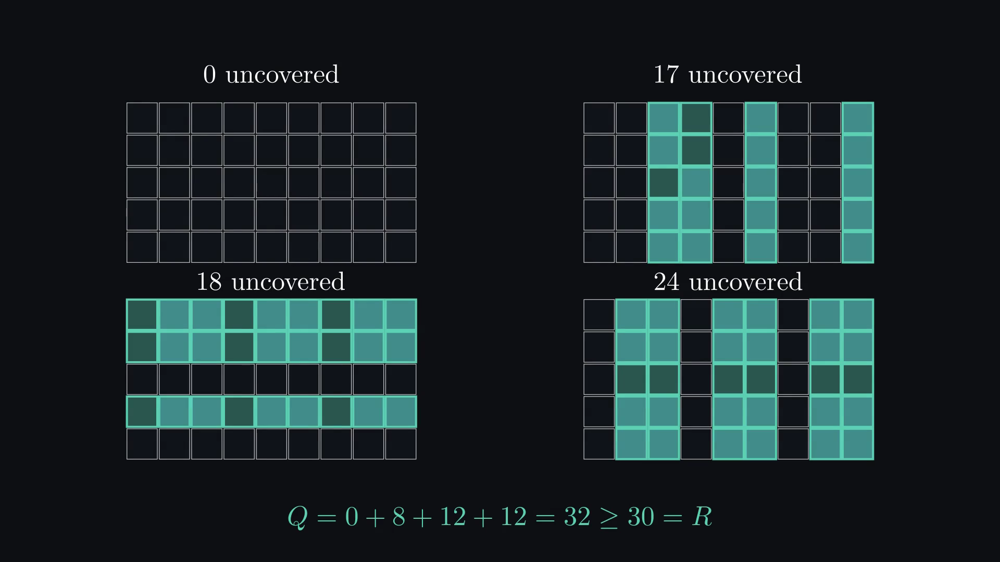</a>

**New-result candidate** · Number theory / Covering systems

A covering system is a finite list of congruences that together catch every integer. None exists when the moduli are distinct, all at least 6, and all divide 2^a * 45. This answers a problem posed in a May 2026 preprint.

- **Result.** No finite distinct covering with all moduli at least six dividing 2^a*45, for any a.
- **Boundary.** The odd-part-135/minimum-eight extension is excluded.
- **Paper:** [PDF](public-release/papers/min-modulus-six-odd-part-45.pdf) · [LaTeX](maths/number-theory/covering-systems/min-modulus-six-odd-part-45/paper.tex)
- **Video:** [MP4](maths/number-theory/covering-systems/min-modulus-six-odd-part-45/video/video.mp4) · [Subtitles](maths/number-theory/covering-systems/min-modulus-six-odd-part-45/video/subtitles.srt) · [Script and QA](maths/number-theory/covering-systems/min-modulus-six-odd-part-45/video/README.md)
- **Checks:** [Verification](maths/number-theory/covering-systems/min-modulus-six-odd-part-45/verification/README.md) · [Review state](maths/number-theory/covering-systems/min-modulus-six-odd-part-45/readiness.md)
- **Formal:** No Lean formalization; the evidence is the written proof and the exact checks.
- **Package:** [maths/number-theory/covering-systems/min-modulus-six-odd-part-45](maths/number-theory/covering-systems/min-modulus-six-odd-part-45/)

### Winning permutation races by rotation

<a href="maths/probability/competing-patterns/rotation-wins-penney/video/video.mp4">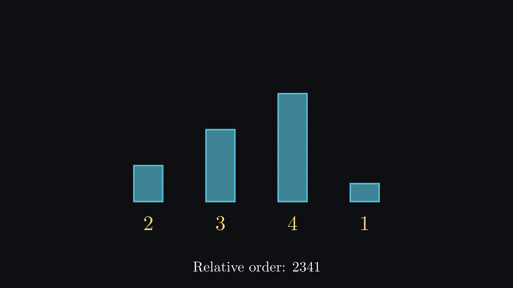</a>

**New-result candidate** · Probability / Competing patterns

In Penney's game, each player picks a pattern and whoever's pattern appears first in a random sequence wins. For patterns of relative order in random numbers, moving the last symbol of any pattern of length three or more to the front gives a reply that wins more than half the time.

- **Result.** Right rotation beats every permutation of length at least three under independent continuous observations.
- **Boundary.** The rotation is a winning reply, not necessarily the optimal reply.
- **Paper:** [PDF](public-release/papers/rotation-wins-penney.pdf) · [LaTeX](maths/probability/competing-patterns/rotation-wins-penney/paper.tex)
- **Video:** [MP4](maths/probability/competing-patterns/rotation-wins-penney/video/video.mp4) · [Subtitles](maths/probability/competing-patterns/rotation-wins-penney/video/subtitles.srt) · [Script and QA](maths/probability/competing-patterns/rotation-wins-penney/video/README.md)
- **Checks:** [Verification](maths/probability/competing-patterns/rotation-wins-penney/verification/README.md)
- **Formal:** No Lean formalization; the evidence is the written proof and the exact checks.
- **Package:** [maths/probability/competing-patterns/rotation-wins-penney](maths/probability/competing-patterns/rotation-wins-penney/)

### Why integer tree-balance weights fail

<a href="maths/combinatorics/phylogenetics/colless-like-integer-weights/video/video.mp4">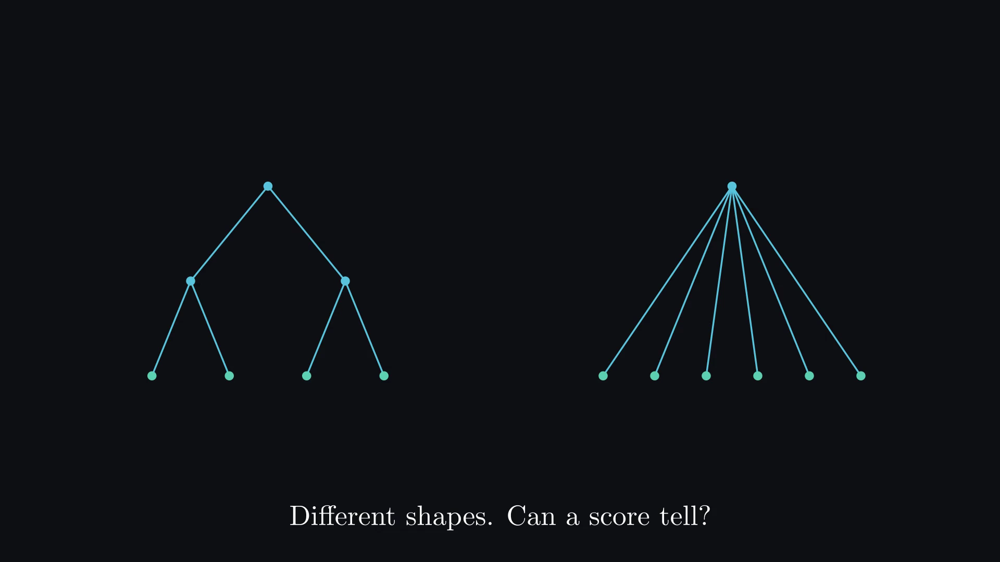</a>

**New-result candidate** · Combinatorics / Phylogenetics

Colless-like indices measure how lopsided an evolutionary tree is. A 2018 conjecture said no whole-number weighting can make such an index zero exactly on perfectly symmetric trees. A short counting argument proves it.

- **Result.** Nonnegative weights with f(2), f(3), f(4) in one cyclic real lattice cannot yield a sound Colless-like index.
- **Boundary.** The result does not exclude all real-valued weights.
- **Paper:** [PDF](public-release/papers/colless-like-integer-weights.pdf) · [LaTeX](maths/combinatorics/phylogenetics/colless-like-integer-weights/paper.tex)
- **Video:** [MP4](maths/combinatorics/phylogenetics/colless-like-integer-weights/video/video.mp4) · [Subtitles](maths/combinatorics/phylogenetics/colless-like-integer-weights/video/subtitles.srt) · [Script and QA](maths/combinatorics/phylogenetics/colless-like-integer-weights/video/README.md)
- **Checks:** [Verification](maths/combinatorics/phylogenetics/colless-like-integer-weights/verification/README.md) · [Review state](maths/combinatorics/phylogenetics/colless-like-integer-weights/readiness.md)
- **Formal:** No Lean formalization; the evidence is the written proof and the exact checks.
- **Package:** [maths/combinatorics/phylogenetics/colless-like-integer-weights](maths/combinatorics/phylogenetics/colless-like-integer-weights/)

### Periodic symplectic billiards in special octagons

<a href="maths/dynamical-systems/billiards/special-octagon-symplectic-billiards/video/video.mp4">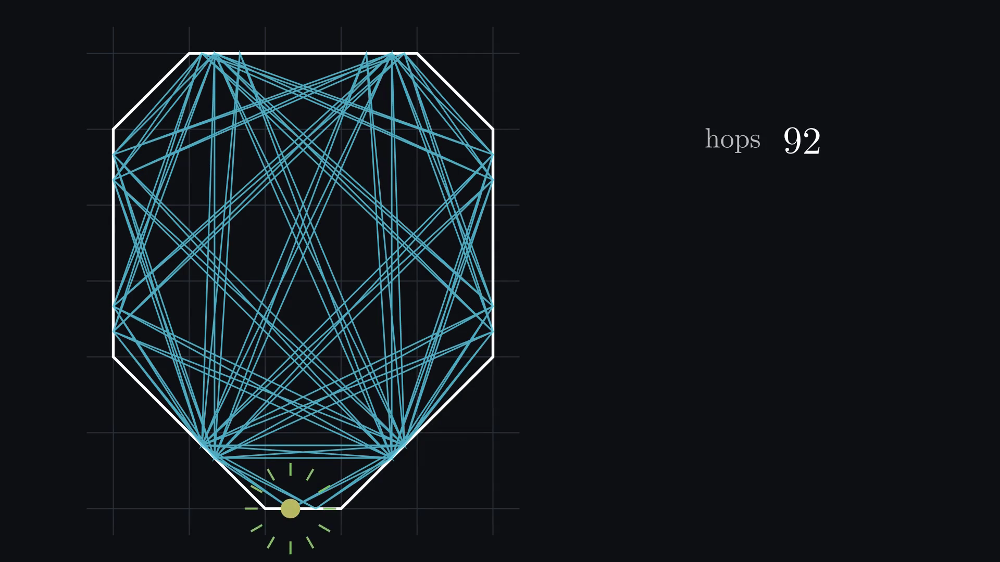</a>

**New-result candidate** · Dynamical systems / Billiards

Symplectic billiards is a variant of billiards whose moves preserve area. Computer experiments suggested that every trajectory in a family of special octagons eventually repeats. This proves it, with an explicit bound on the period, and extends it to mirror-symmetric Hexhouses.

- **Result.** Every orbit is periodic for special lattice octagons and mirror-symmetric Hexhouses, with an explicit bound.
- **Boundary.** Asymmetric Hexhouses and general Penthouses remain open.
- **Paper:** [PDF](public-release/papers/special-octagon-symplectic-billiards.pdf) · [LaTeX](maths/dynamical-systems/billiards/special-octagon-symplectic-billiards/paper.tex)
- **Video:** [MP4](maths/dynamical-systems/billiards/special-octagon-symplectic-billiards/video/video.mp4) · [Subtitles](maths/dynamical-systems/billiards/special-octagon-symplectic-billiards/video/subtitles.srt) · [Script and QA](maths/dynamical-systems/billiards/special-octagon-symplectic-billiards/video/README.md)
- **Checks:** [Verification](maths/dynamical-systems/billiards/special-octagon-symplectic-billiards/verification/README.md)
- **Formal:** No Lean formalization; the evidence is the written proof and the exact checks.
- **Package:** [maths/dynamical-systems/billiards/special-octagon-symplectic-billiards](maths/dynamical-systems/billiards/special-octagon-symplectic-billiards/)

### Infinite words avoiding Cartesian-tree squares

<a href="maths/combinatorics/combinatorics-on-words/cartesian-tree-square-free-words/video/video.mp4">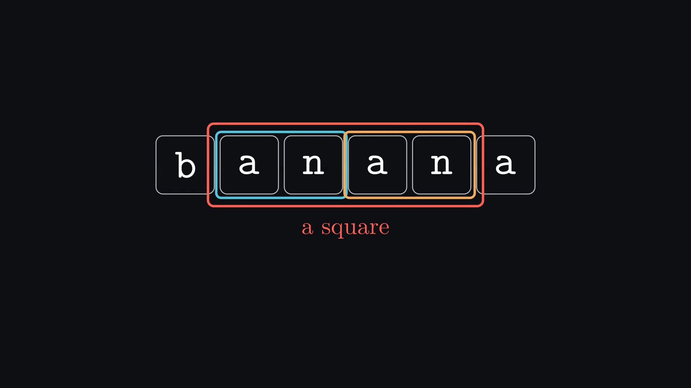</a>

**New-result candidate** · Combinatorics / Combinatorics on words

A square is a block written twice in a row. Relaxing 'the same block' to 'the same Cartesian-tree shape', explicit infinite binary and ternary words avoid all long squares of this kind, settling the remaining open entries of a 2026 table.

- **Result.** Explicit binary and ternary morphisms settle the source's remaining infinite-word table entries.
- **Boundary.** The long-word deduction is written mathematics with independently checked finite cases, not a Lean theorem.
- **Paper:** [PDF](public-release/papers/cartesian-tree-square-free-words.pdf) · [LaTeX](maths/combinatorics/combinatorics-on-words/cartesian-tree-square-free-words/paper.tex)
- **Video:** [MP4](maths/combinatorics/combinatorics-on-words/cartesian-tree-square-free-words/video/video.mp4) · [Subtitles](maths/combinatorics/combinatorics-on-words/cartesian-tree-square-free-words/video/subtitles.srt) · [Script and QA](maths/combinatorics/combinatorics-on-words/cartesian-tree-square-free-words/video/README.md)
- **Checks:** [Verification](maths/combinatorics/combinatorics-on-words/cartesian-tree-square-free-words/verification/README.md)
- **Formal:** No Lean formalization; the evidence is the written proof and the exact checks.
- **Package:** [maths/combinatorics/combinatorics-on-words/cartesian-tree-square-free-words](maths/combinatorics/combinatorics-on-words/cartesian-tree-square-free-words/)

### Reduced graphs with four negative eigenvalues

<a href="maths/combinatorics/spectral-graph-theory/four-negative-eigenvalues/video/video.mp4">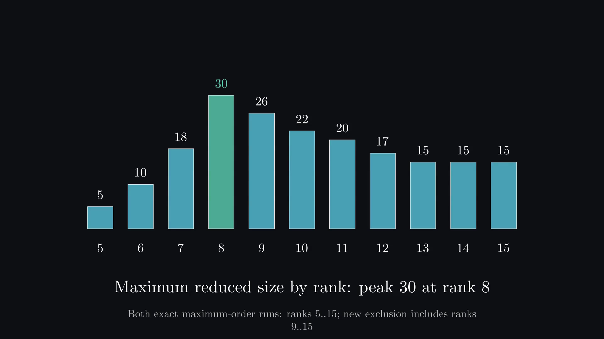</a>

**New-result candidate** · Combinatorics / Spectral graph theory

The number of negative eigenvalues of a graph limits how large it can be once duplicate and isolated vertices are removed. With four negative eigenvalues the maximum is 30 vertices, the first open case of a conjectured bound.

- **Result.** The maximum reduced order is 30; higher ranks are excluded and two positive-inertia extremizers are classified.
- **Boundary.** The four order-30 rank-eight graphs and the numerical bound A4=11 were already known.
- **Paper:** [PDF](public-release/papers/four-negative-eigenvalues.pdf) · [LaTeX](maths/combinatorics/spectral-graph-theory/four-negative-eigenvalues/paper.tex)
- **Video:** [MP4](maths/combinatorics/spectral-graph-theory/four-negative-eigenvalues/video/video.mp4) · [Subtitles](maths/combinatorics/spectral-graph-theory/four-negative-eigenvalues/video/subtitles.srt) · [Script and QA](maths/combinatorics/spectral-graph-theory/four-negative-eigenvalues/video/README.md)
- **Checks:** [Verification](maths/combinatorics/spectral-graph-theory/four-negative-eigenvalues/verification/README.md) · [Review state](maths/combinatorics/spectral-graph-theory/four-negative-eigenvalues/readiness.md)
- **Formal:** No Lean formalization; the evidence is the written proof and the exact checks.
- **Package:** [maths/combinatorics/spectral-graph-theory/four-negative-eigenvalues](maths/combinatorics/spectral-graph-theory/four-negative-eigenvalues/)

### How cheaply can the first player win Hex?

<a href="maths/combinatorics/combinatorial-games/hex-short-wins/video/video.mp4">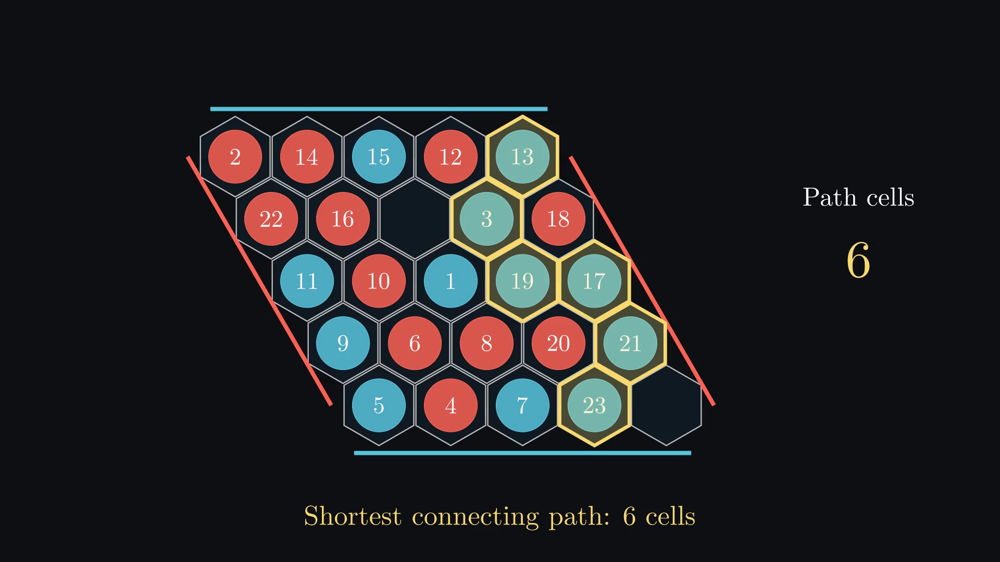</a>

**New-result candidate** · Combinatorics / Combinatorial games

In Hex, how short a winning path can the first player force, and with how few stones? Exhaustive search with replayable certificates settles several values on the 5x5 and 6x6 boards, including a shortest forced path of six cells on 5x5, below the conjectured seven.

- **Result.** Certified lambda(5)=lambda*(5)=6, delta(5)=7, delta(6)=10 and lambda(6)>=8.
- **Boundary.** The matching lambda(6)<=8 is search-only. No strict-rule value at six is claimed.
- **Paper:** [PDF](public-release/papers/hex-short-wins.pdf) · [LaTeX](maths/combinatorics/combinatorial-games/hex-short-wins/paper.tex)
- **Video:** [MP4](maths/combinatorics/combinatorial-games/hex-short-wins/video/video.mp4) · [Subtitles](maths/combinatorics/combinatorial-games/hex-short-wins/video/subtitles.srt) · [Script and QA](maths/combinatorics/combinatorial-games/hex-short-wins/video/README.md)
- **Checks:** [Verification](maths/combinatorics/combinatorial-games/hex-short-wins/verification/README.md) · [Review state](maths/combinatorics/combinatorial-games/hex-short-wins/readiness.md)
- **Formal:** No Lean formalization; the evidence is the written proof and the exact checks.
- **Package:** [maths/combinatorics/combinatorial-games/hex-short-wins](maths/combinatorics/combinatorial-games/hex-short-wins/)

### Bridge and meridional rank of thirteen-crossing knots

<a href="maths/topology/knot-theory/bridge-thirteen-crossing-census/video/video.mp4">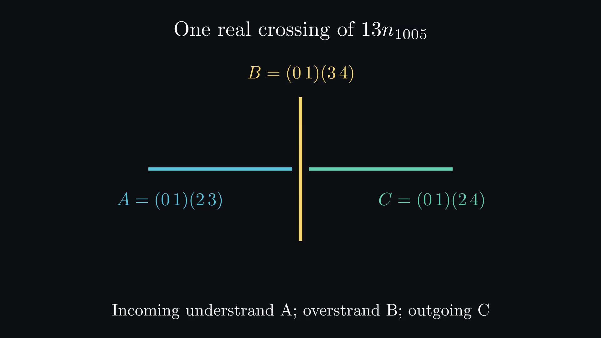</a>

**New-result candidate** · Topology / Knot theory

The bridge number measures how simply a knot can be laid out in space. For 25 thirteen-crossing knots whose value was listed only as 3 or 4, finite certificates show it is exactly 4.

- **Result.** Twenty-five entries in a pinned 293-name list have bridge number and meridional rank four.
- **Boundary.** Novel relative to the pinned list; overlap with broader family theorems remains a priority question.
- **Paper:** [PDF](public-release/papers/bridge-thirteen-crossing-census.pdf) · [LaTeX](maths/topology/knot-theory/bridge-thirteen-crossing-census/paper.tex)
- **Video:** [MP4](maths/topology/knot-theory/bridge-thirteen-crossing-census/video/video.mp4) · [Subtitles](maths/topology/knot-theory/bridge-thirteen-crossing-census/video/subtitles.srt) · [Script and QA](maths/topology/knot-theory/bridge-thirteen-crossing-census/video/README.md)
- **Checks:** [Verification](maths/topology/knot-theory/bridge-thirteen-crossing-census/verification/README.md)
- **Formal:** No Lean formalization; the evidence is the written proof and the exact checks.
- **Package:** [maths/topology/knot-theory/bridge-thirteen-crossing-census](maths/topology/knot-theory/bridge-thirteen-crossing-census/)

### Bilinear complexity over small finite fields

<a href="maths/algebra/bilinear-complexity/mu-q-2-2/video/video.mp4">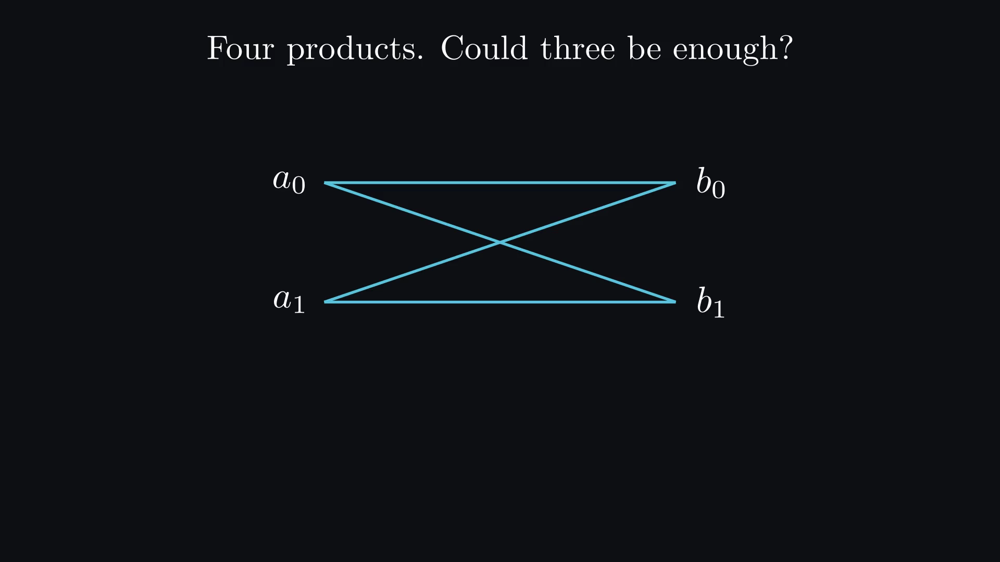</a>

**New-result candidate** · Algebra / Bilinear complexity

How many multiplications does it take to multiply in a small algebra over a finite field? For one basic algebra the exact count is found over every finite field. As a corollary, length-6 cyclic convolution over two elements needs exactly 12.

- **Result.** mu_q(2,2)=mu_q^sym(2,2): 9 for q=2, 8 for q=3,4,5, and 7 for q>=7; binary length-six cyclic convolution has rank 12.
- **Boundary.** The symmetric binary value, q=4 claim and search methods have prior sources; novelty is narrower than the full table.
- **Paper:** [PDF](public-release/papers/mu-q-2-2.pdf) · [LaTeX](maths/algebra/bilinear-complexity/mu-q-2-2/paper.tex)
- **Video:** [MP4](maths/algebra/bilinear-complexity/mu-q-2-2/video/video.mp4) · [Subtitles](maths/algebra/bilinear-complexity/mu-q-2-2/video/subtitles.srt) · [Script and QA](maths/algebra/bilinear-complexity/mu-q-2-2/video/README.md)
- **Checks:** [Verification](maths/algebra/bilinear-complexity/mu-q-2-2/verification/README.md) · [Review state](maths/algebra/bilinear-complexity/mu-q-2-2/readiness.md)
- **Formal:** No Lean formalization; the evidence is the written proof and the exact checks.
- **Package:** [maths/algebra/bilinear-complexity/mu-q-2-2](maths/algebra/bilinear-complexity/mu-q-2-2/)

### An eleven-neuron stable nonclique network

<a href="maths/dynamical-systems/threshold-linear-networks/standard-parameter-counterexamples/video/video.mp4">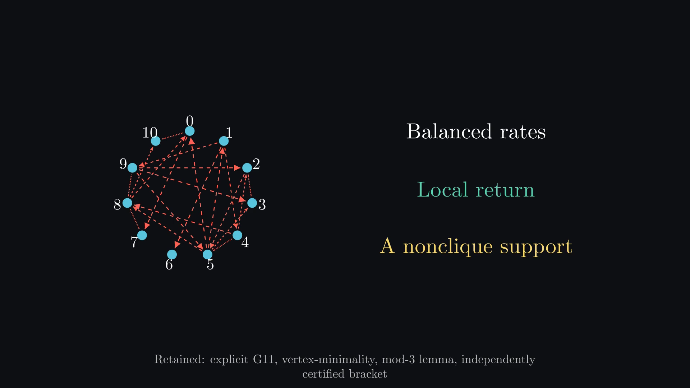</a>

**New-result candidate** · Dynamical systems / Threshold linear networks

Threshold-linear networks are simple models of neural circuits. A conjecture said stable activity can only sit on a special kind of clique. An exact 11-neuron counterexample works at the standard parameters used across the literature and is minimal under deleting neurons.

- **Result.** An exact standard-parameter counterexample is minimal under vertex deletion; the global minimum lies from eight to eleven.
- **Boundary.** Standard-parameter counterexamples were already implied by prior families. Eleven is not proved globally minimal.
- **Paper:** [PDF](public-release/papers/standard-parameter-counterexamples.pdf) · [LaTeX](maths/dynamical-systems/threshold-linear-networks/standard-parameter-counterexamples/paper.tex)
- **Video:** [MP4](maths/dynamical-systems/threshold-linear-networks/standard-parameter-counterexamples/video/video.mp4) · [Subtitles](maths/dynamical-systems/threshold-linear-networks/standard-parameter-counterexamples/video/subtitles.srt) · [Script and QA](maths/dynamical-systems/threshold-linear-networks/standard-parameter-counterexamples/video/README.md)
- **Checks:** [Verification](maths/dynamical-systems/threshold-linear-networks/standard-parameter-counterexamples/verification/README.md) · [Review state](maths/dynamical-systems/threshold-linear-networks/standard-parameter-counterexamples/readiness.md)
- **Formal:** No Lean formalization; the evidence is the written proof and the exact checks.
- **Package:** [maths/dynamical-systems/threshold-linear-networks/standard-parameter-counterexamples](maths/dynamical-systems/threshold-linear-networks/standard-parameter-counterexamples/)

### Certified rings around marked tiles

<a href="maths/geometry/tilings/marked-polyform-heesch-numbers/video/video.mp4">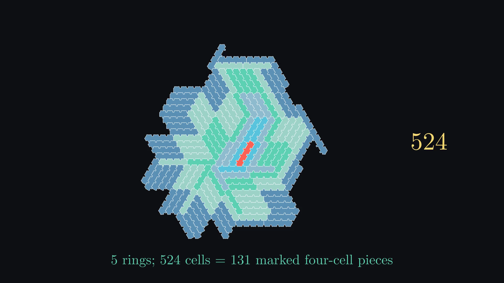</a>

**New-result candidate** · Geometry / Tilings

The Heesch number counts how many complete rings of copies can surround a shape that cannot tile the plane. For small hexagon and square shapes with marked edges, 34 exact maxima are computed, with witnesses and checked proofs that no marking does better.

- **Result.** Thirty-four exact maxima over unbalanced single-slot lattice markings, with witnesses and checked exclusion proofs.
- **Boundary.** No new Heesch record or off-grid upper bound; overlap with smaller prior tables remains unresolved.
- **Paper:** [PDF](public-release/papers/marked-polyform-heesch-numbers.pdf) · [LaTeX](maths/geometry/tilings/marked-polyform-heesch-numbers/paper.tex)
- **Video:** [MP4](maths/geometry/tilings/marked-polyform-heesch-numbers/video/video.mp4) · [Subtitles](maths/geometry/tilings/marked-polyform-heesch-numbers/video/subtitles.srt) · [Script and QA](maths/geometry/tilings/marked-polyform-heesch-numbers/video/README.md)
- **Checks:** [Verification](maths/geometry/tilings/marked-polyform-heesch-numbers/verification/README.md) · [Review state](maths/geometry/tilings/marked-polyform-heesch-numbers/readiness.md)
- **Formal:** No Lean formalization; the evidence is the written proof and the exact checks.
- **Package:** [maths/geometry/tilings/marked-polyform-heesch-numbers](maths/geometry/tilings/marked-polyform-heesch-numbers/)

### A shorter certificate for seven-cube tic-tac-toe

<a href="maths/combinatorics/combinatorial-games/cubic-tic-tac-toe-surplus/video/video.mp4">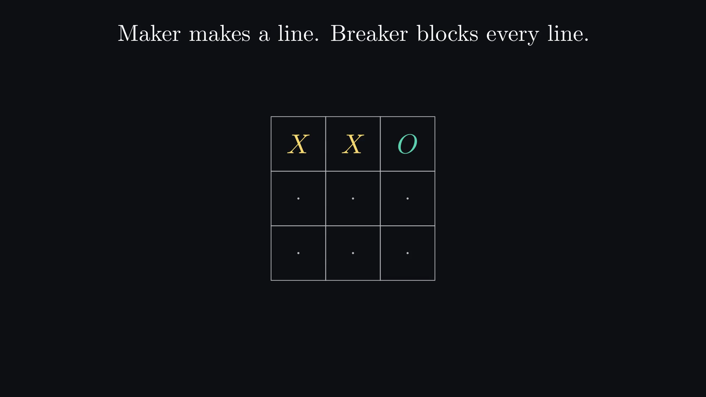</a>

**New proof of a known theorem, with a correction** · Combinatorics / Combinatorial games

In Maker-Breaker tic-tac-toe on a 7x7x7 cube, the second player can always stop the first from claiming a full line. That was already proved. This gives a shorter certificate based on matching theory and repairs omissions in the published case analysis.

- **Result.** A Hall-surplus proof of the known Breaker win repairs omissions in the published case analysis.
- **Boundary.** Six-cube and five-cube games remain open; Lean covers the abstract matching lemmas only.
- **Paper:** [PDF](public-release/papers/cubic-tic-tac-toe-surplus.pdf) · [LaTeX](maths/combinatorics/combinatorial-games/cubic-tic-tac-toe-surplus/paper.tex)
- **Video:** [MP4](maths/combinatorics/combinatorial-games/cubic-tic-tac-toe-surplus/video/video.mp4) · [Subtitles](maths/combinatorics/combinatorial-games/cubic-tic-tac-toe-surplus/video/subtitles.srt) · [Script and QA](maths/combinatorics/combinatorial-games/cubic-tic-tac-toe-surplus/video/README.md)
- **Checks:** [Verification](maths/combinatorics/combinatorial-games/cubic-tic-tac-toe-surplus/verification/README.md)
- **Formal:** [CubicTicTacToe.lean](formal/ValyuResearch/CubicTicTacToe.lean) (abstract matching lemmas only; not the board enumeration or the game conclusion). See [formal coverage](docs/formal-coverage.md).
- **Package:** [maths/combinatorics/combinatorial-games/cubic-tic-tac-toe-surplus](maths/combinatorics/combinatorial-games/cubic-tic-tac-toe-surplus/)

### Counting staircase Latin tableaux

<a href="maths/combinatorics/latin-squares/latin-tableaux-staircase-count/video/video.mp4">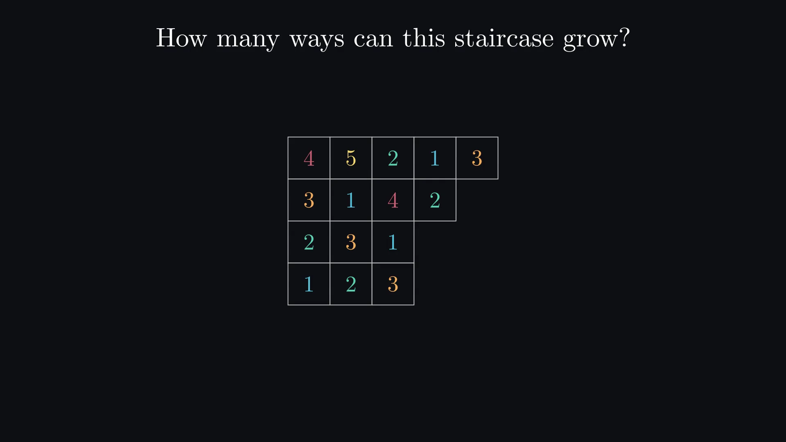</a>

**Independent verification; no priority claim** · Combinatorics / Latin squares

A Latin tableau fills a staircase-like shape so that each row uses each number once and no column repeats. This independently checks the count 9*4^(k-3) for one family. The same formula was already proved publicly, so no priority is claimed.

- **Result.** An independently checked induction gives 9*4^(k-3), with a 576-tableau base case.
- **Boundary.** An earlier public proof has the same formula and four-extension mechanism. No novelty claim.
- **Paper:** [PDF](public-release/papers/latin-tableaux-staircase-count.pdf) · [LaTeX](maths/combinatorics/latin-squares/latin-tableaux-staircase-count/paper.tex)
- **Video:** [MP4](maths/combinatorics/latin-squares/latin-tableaux-staircase-count/video/video.mp4) · [Subtitles](maths/combinatorics/latin-squares/latin-tableaux-staircase-count/video/subtitles.srt) · [Script and QA](maths/combinatorics/latin-squares/latin-tableaux-staircase-count/video/README.md)
- **Checks:** [Verification](maths/combinatorics/latin-squares/latin-tableaux-staircase-count/verification/)
- **Formal:** No Lean formalization; the evidence is the written proof and the exact checks.
- **Package:** [maths/combinatorics/latin-squares/latin-tableaux-staircase-count](maths/combinatorics/latin-squares/latin-tableaux-staircase-count/)

### Prime-successor Hales-Jewett numbers

<a href="maths/combinatorics/ramsey-theory/prime-successor-hales-jewett/video/video.mp4">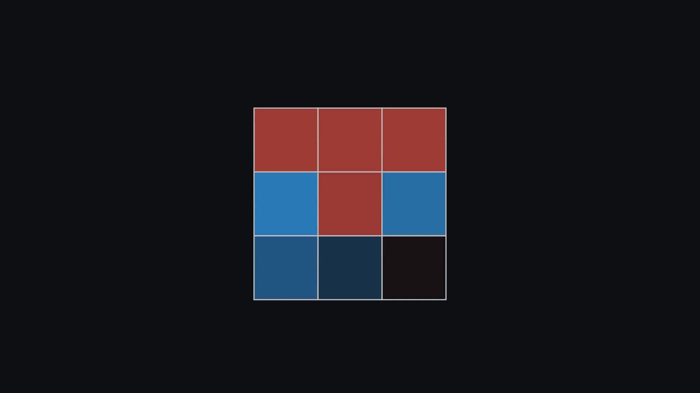</a>

**New-result candidate** · Combinatorics / Ramsey theory

Hales-Jewett numbers measure how large a grid of words must be before every two-colouring contains a forced line pattern. For an off-diagonal version, the answer is p+1 whenever p is prime, and the complete main theorem is checked in Lean.

- **Result.** HJ(p+1,2;2)=p+1 for every prime p, with a complete Lean proof.
- **Boundary.** The off-diagonal convention matters; the source's geometric G(8,2) computation is not independently certified.
- **Paper:** [PDF](public-release/papers/prime-successor-hales-jewett.pdf) · [LaTeX](maths/combinatorics/ramsey-theory/prime-successor-hales-jewett/paper.tex)
- **Video:** [MP4](maths/combinatorics/ramsey-theory/prime-successor-hales-jewett/video/video.mp4) · [Subtitles](maths/combinatorics/ramsey-theory/prime-successor-hales-jewett/video/subtitles.srt) · [Script and QA](maths/combinatorics/ramsey-theory/prime-successor-hales-jewett/video/README.md)
- **Checks:** [Verification](maths/combinatorics/ramsey-theory/prime-successor-hales-jewett/verification/README.md) · [Review state](maths/combinatorics/ramsey-theory/prime-successor-hales-jewett/readiness.md)
- **Formal:** [HalesJewett.lean](formal/ValyuResearch/HalesJewett.lean) (complete prime-successor theorem). See [formal coverage](docs/formal-coverage.md).
- **Package:** [maths/combinatorics/ramsey-theory/prime-successor-hales-jewett](maths/combinatorics/ramsey-theory/prime-successor-hales-jewett/)

### Local rigidity of the truncated dodecahedron

**New-result candidate** · Geometry / Rigidity

If the truncated dodecahedron keeps every edge length and every face flat, can it wobble? Exact finite-field certificates prove that it cannot, settling a case left open in a 2026 study of polytope deformations.

- **Result.** An exact higher-order certificate proves local rigidity with fixed edges and planar faces.
- **Boundary.** Does not prove global uniqueness or rigidity with only bar constraints.
- **Paper:** [PDF](public-release/papers/truncated-dodecahedron.pdf) · [LaTeX](maths/geometry/rigidity/truncated-dodecahedron/paper.tex)
- **Video:** [MP4](maths/geometry/rigidity/truncated-dodecahedron/video/video.mp4) · [Subtitles](maths/geometry/rigidity/truncated-dodecahedron/video/subtitles.srt) · [Script and QA](maths/geometry/rigidity/truncated-dodecahedron/video/README.md)
- **Checks:** [Verification](maths/geometry/rigidity/truncated-dodecahedron/verification/) · [Review state](maths/geometry/rigidity/truncated-dodecahedron/readiness.md)
- **Formal:** No Lean formalization; the evidence is the written proof and the exact checks.
- **Package:** [maths/geometry/rigidity/truncated-dodecahedron](maths/geometry/rigidity/truncated-dodecahedron/)

### Reconstructing generic Lotka-Volterra trees

<a href="maths/dynamical-systems/lotka-volterra/tree-equivalence/video/video.mp4">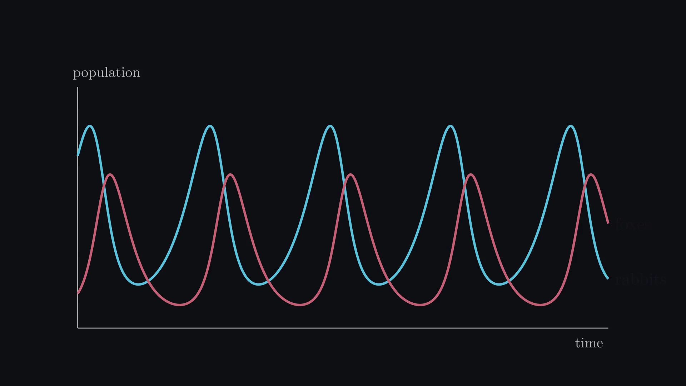</a>

**Independent verification; no priority claim** · Dynamical systems / Lotka volterra

Lotka-Volterra equations model interacting species. This is a self-contained proof that generic tree-shaped systems are determined up to linear equivalence. An earlier withdrawn preprint announced a closely matching result, so it is a verification note, not a priority claim.

- **Result.** A self-contained reconstruction and verification note with an exact path-obstruction lemma.
- **Boundary.** An earlier withdrawn announcement closely overlaps; no priority claim.
- **Paper:** [PDF](public-release/papers/tree-equivalence.pdf) · [LaTeX](maths/dynamical-systems/lotka-volterra/tree-equivalence/paper.tex)
- **Video:** [MP4](maths/dynamical-systems/lotka-volterra/tree-equivalence/video/video.mp4) · [Subtitles](maths/dynamical-systems/lotka-volterra/tree-equivalence/video/subtitles.srt) · [Script and QA](maths/dynamical-systems/lotka-volterra/tree-equivalence/video/README.md)
- **Checks:** [Verification](maths/dynamical-systems/lotka-volterra/tree-equivalence/verification/README.md) · [Review state](maths/dynamical-systems/lotka-volterra/tree-equivalence/readiness.md)
- **Formal:** [LotkaVolterra.lean](formal/ValyuResearch/LotkaVolterra.lean) (three-vertex path obstruction only). See [formal coverage](docs/formal-coverage.md).
- **Package:** [maths/dynamical-systems/lotka-volterra/tree-equivalence](maths/dynamical-systems/lotka-volterra/tree-equivalence/)

## Physics

### Distance-three qudit stabilizer codes

<a href="physics/quantum-information/error-correction/distance-three-qudit-codes/video/video.mp4">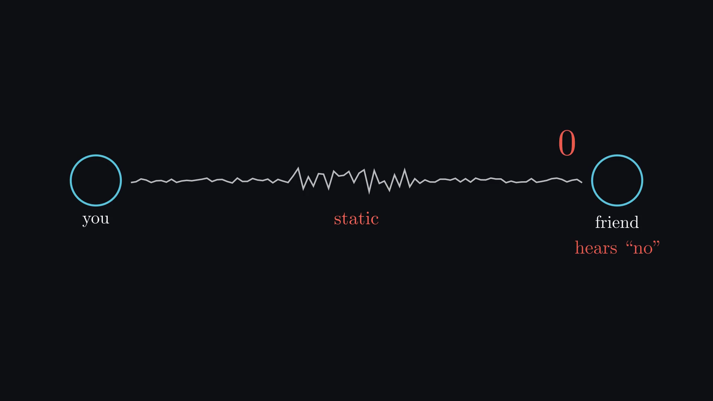</a>

**New-result candidate** · Quantum information / Error correction

Quantum error-correcting codes protect information stored in multi-level quantum systems. For linear stabilizer codes that correct any single error over a field with at least three elements, this determines exactly which code lengths are possible.

- **Result.** Complete admissible lengths for F_q-linear stabilizer codes, q>=3; twelve pinned table entries improve, eleven become exact.
- **Boundary.** Known endpoint families and support-removal methods are credited. Nonlinear codes and general additive non-prime-field codes are outside the classification.
- **Paper:** [PDF](public-release/papers/distance-three-qudit-codes.pdf) · [LaTeX](physics/quantum-information/error-correction/distance-three-qudit-codes/paper.tex)
- **Video:** [MP4](physics/quantum-information/error-correction/distance-three-qudit-codes/video/video.mp4) · [Subtitles](physics/quantum-information/error-correction/distance-three-qudit-codes/video/subtitles.srt) · [Script and QA](physics/quantum-information/error-correction/distance-three-qudit-codes/video/README.md)
- **Checks:** [Verification](physics/quantum-information/error-correction/distance-three-qudit-codes/verification/README.md)
- **Formal:** No Lean formalization; the evidence is the written proof and the exact checks.
- **Package:** [physics/quantum-information/error-correction/distance-three-qudit-codes](physics/quantum-information/error-correction/distance-three-qudit-codes/)

### Response bounds on cactus networks

<a href="physics/statistical-physics/nonequilibrium-response/cactus-response-coupling/video/video.mp4">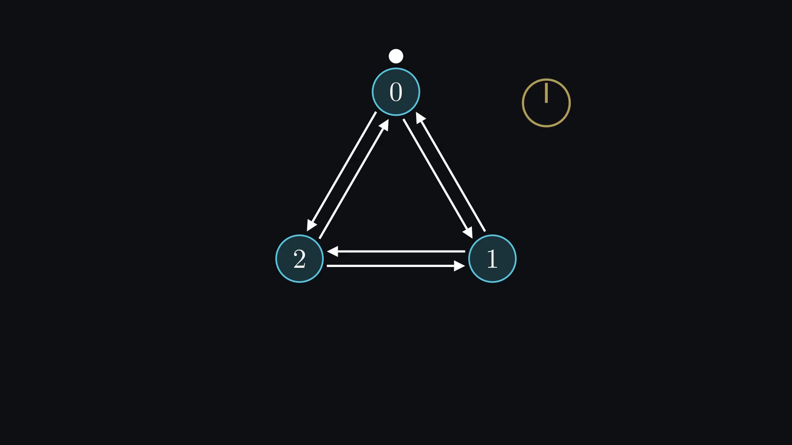</a>

**New-result candidate** · Statistical physics / Nonequilibrium response

In a network of random jumps between states, how sensitive is long-run behaviour to a change in the rates? A conjectured topological bound holds for every cactus-shaped network, and a stronger proof method provably fails on more connected graphs.

- **Result.** The topological response conjecture holds on all cacti; a stronger coupling method fails on graphs with a K4 minor.
- **Boundary.** The obstruction concerns the method, not a counterexample to the general response conjecture.
- **Paper:** [PDF](public-release/papers/cactus-response-coupling.pdf) · [LaTeX](physics/statistical-physics/nonequilibrium-response/cactus-response-coupling/paper.tex)
- **Video:** [MP4](physics/statistical-physics/nonequilibrium-response/cactus-response-coupling/video/video.mp4) · [Subtitles](physics/statistical-physics/nonequilibrium-response/cactus-response-coupling/video/subtitles.srt) · [Script and QA](physics/statistical-physics/nonequilibrium-response/cactus-response-coupling/video/README.md)
- **Checks:** [Verification](physics/statistical-physics/nonequilibrium-response/cactus-response-coupling/verification/README.md)
- **Formal:** No Lean formalization; the evidence is the written proof and the exact checks.
- **Package:** [physics/statistical-physics/nonequilibrium-response/cactus-response-coupling](physics/statistical-physics/nonequilibrium-response/cactus-response-coupling/)

### Generic three-dimensional stiffness recovery

**New-result candidate** · Mechanics / Elasticity

Can the full stiffness of an anisotropic material be recovered from how fast waves travel through it? For generic materials, wave speeds in eleven generic directions determine all 21 stiffness parameters, resolving a published conjecture.

- **Result.** Generic density-normalized stiffness is determined by eleven generic wave-measurement directions.
- **Boundary.** Full geometric proof is not formalized; stable inversion and optimal direction count remain open.
- **Paper:** [PDF](public-release/papers/generic-stiffness-recovery.pdf) · [LaTeX](physics/mechanics/elasticity/generic-stiffness-recovery/paper.tex)
- **Video:** [MP4](physics/mechanics/elasticity/generic-stiffness-recovery/video/video.mp4) · [Subtitles](physics/mechanics/elasticity/generic-stiffness-recovery/video/subtitles.srt) · [Script and QA](physics/mechanics/elasticity/generic-stiffness-recovery/video/README.md)
- **Checks:** [Verification](physics/mechanics/elasticity/generic-stiffness-recovery/verification/README.md) · [Review state](physics/mechanics/elasticity/generic-stiffness-recovery/READINESS.md)
- **Formal:** [Elasticity.lean](formal/ValyuResearch/Elasticity.lean) (seven 3x3 matrix lemmas used in the proof); [lean-certificate-checks](physics/mechanics/elasticity/generic-stiffness-recovery/verification/lean-certificate-checks/) (eleven minor determinant identities, in a separate package). See [formal coverage](docs/formal-coverage.md).
- **Package:** [physics/mechanics/elasticity/generic-stiffness-recovery](physics/mechanics/elasticity/generic-stiffness-recovery/)

### A periodic waiting-time entropy counterexample

<a href="physics/statistical-physics/thermodynamic-inference/periodic-waiting-time/video/video.mp4">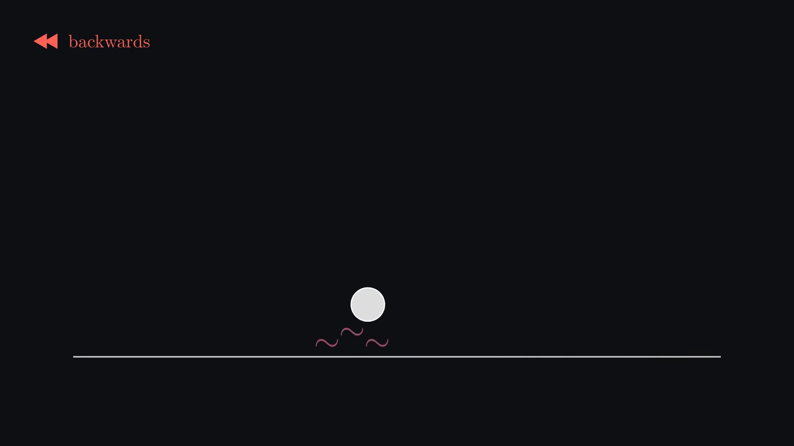</a>

**New-result candidate** · Statistical physics / Thermodynamic inference

Entropy production measures how far a system is from equilibrium. A published conjecture proposed bounding it from waiting times under a forward protocol. A smooth three-state example has zero entropy production but a strictly positive estimate, so the conjectured bound fails as stated.

- **Result.** A smooth three-state counterexample to a specific forward-protocol entropy-bound conjecture.
- **Boundary.** Protocol-reversal results remain intact; the broad false-positive mechanism has prior examples.
- **Paper:** [PDF](public-release/papers/periodic-waiting-time.pdf) · [LaTeX](physics/statistical-physics/thermodynamic-inference/periodic-waiting-time/paper.tex)
- **Video:** [MP4](physics/statistical-physics/thermodynamic-inference/periodic-waiting-time/video/video.mp4) · [Subtitles](physics/statistical-physics/thermodynamic-inference/periodic-waiting-time/video/subtitles.srt) · [Script and QA](physics/statistical-physics/thermodynamic-inference/periodic-waiting-time/video/README.md)
- **Checks:** [Verification](physics/statistical-physics/thermodynamic-inference/periodic-waiting-time/verification/README.md) · [Review state](physics/statistical-physics/thermodynamic-inference/periodic-waiting-time/readiness.md)
- **Formal:** No Lean formalization; the evidence is the written proof and the exact checks.
- **Package:** [physics/statistical-physics/thermodynamic-inference/periodic-waiting-time](physics/statistical-physics/thermodynamic-inference/periodic-waiting-time/)

### Global optimality of conjugate restart laws

<a href="physics/statistical-physics/stochastic-resetting/conjugate-restart/video/video.mp4">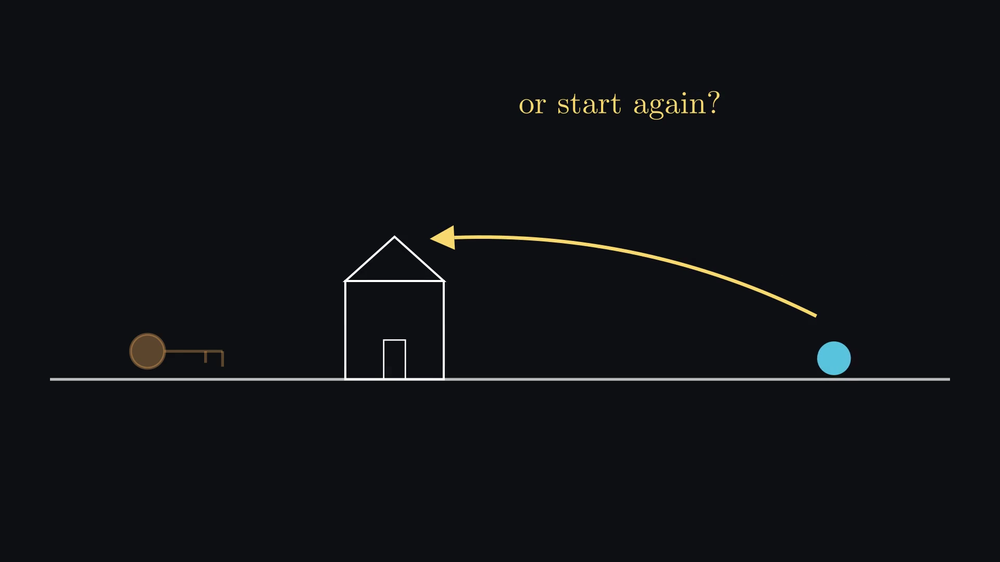</a>

**New-result candidate** · Statistical physics / Stochastic resetting

Restarting a random search can make it faster. For one-dimensional Brownian search, conjugate restart schedules are globally optimal and unique, with a converse for finite Markov chains. The kernel inequality and the exponential conjugate pair are prior work.

- **Result.** A global renewal-law optimum and uniqueness result, with a finite-state converse under cyclicity.
- **Boundary.** The kernel inequality and exponential conjugate pair are prior work; priority remains provisional.
- **Paper:** [PDF](public-release/papers/conjugate-restart.pdf) · [LaTeX](physics/statistical-physics/stochastic-resetting/conjugate-restart/paper.tex)
- **Video:** [MP4](physics/statistical-physics/stochastic-resetting/conjugate-restart/video/video.mp4) · [Subtitles](physics/statistical-physics/stochastic-resetting/conjugate-restart/video/subtitles.srt) · [Script and QA](physics/statistical-physics/stochastic-resetting/conjugate-restart/video/README.md)
- **Checks:** [Verification](physics/statistical-physics/stochastic-resetting/conjugate-restart/verification/README.md) · [Review state](physics/statistical-physics/stochastic-resetting/conjugate-restart/readiness.md)
- **Formal:** [Resetting.lean](formal/ValyuResearch/Resetting.lean) (finite symmetric-kernel identity and minimum, and an exact three-state counterexample). See [formal coverage](docs/formal-coverage.md).
- **Package:** [physics/statistical-physics/stochastic-resetting/conjugate-restart](physics/statistical-physics/stochastic-resetting/conjugate-restart/)

## Chemistry

### Chemical robustness with multiple stable states

**New-result candidate** · Reaction networks / Mass action

In some chemical networks one concentration takes the same value at every steady state, whatever the starting mixture. For networks whose reactions involve at most two molecules on each side, this finds the smallest networks, by dimension and by number of complexes, that combine that robustness with more than one stable state, and shows that three species already suffice.

- **Result.** Minimum stoichiometric dimension three and six complexes for ACR with multistability in at-most-bimolecular networks.
- **Boundary.** The species-three construction is elementary; reaction-count minimum is open. Lean checks examples and ACR, not stability or the general lower bounds.
- **Paper:** [PDF](public-release/papers/acr-multistability-bounds.pdf) · [LaTeX](chemistry/reaction-networks/mass-action/acr-multistability-bounds/paper.tex)
- **Video:** [MP4](chemistry/reaction-networks/mass-action/acr-multistability-bounds/video/video.mp4) · [Subtitles](chemistry/reaction-networks/mass-action/acr-multistability-bounds/video/subtitles.srt) · [Script and QA](chemistry/reaction-networks/mass-action/acr-multistability-bounds/video/README.md)
- **Checks:** [Verification](chemistry/reaction-networks/mass-action/acr-multistability-bounds/verification/README.md) · [Review state](chemistry/reaction-networks/mass-action/acr-multistability-bounds/readiness.md)
- **Formal:** [AcrMultistability.lean](formal/ValyuResearch/AcrMultistability.lean) (the two example networks, their steady states and robustness; not stability or the general lower bounds). See [formal coverage](docs/formal-coverage.md).
- **Package:** [chemistry/reaction-networks/mass-action/acr-multistability-bounds](chemistry/reaction-networks/mass-action/acr-multistability-bounds/)

### Sharp equilibrium counts from cubic sources

<a href="chemistry/reaction-networks/mass-action/cubic-equilibrium-sharpness/video/video.mp4">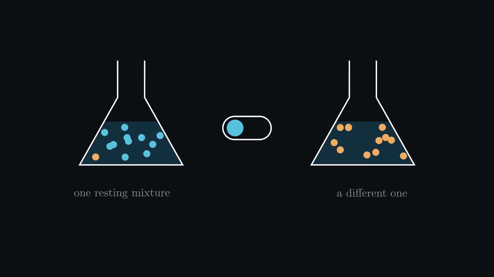</a>

**New-result candidate** · Reaction networks / Mass action

How many equilibria can a chemical reaction network have on one conservation class? An explicit family with n species attains the sharp maximum of n for every n of at least 2, using reactions whose inputs involve at most three molecules, the minimum possible.

- **Result.** An all-n family attains the sharp equilibrium count; source molecularity three is sufficient and minimal.
- **Boundary.** Classes are unbounded, product molecularities may exceed three, and simultaneous stability is unproved.
- **Paper:** [PDF](public-release/papers/cubic-equilibrium-sharpness.pdf) · [LaTeX](chemistry/reaction-networks/mass-action/cubic-equilibrium-sharpness/paper.tex)
- **Video:** [MP4](chemistry/reaction-networks/mass-action/cubic-equilibrium-sharpness/video/video.mp4) · [Subtitles](chemistry/reaction-networks/mass-action/cubic-equilibrium-sharpness/video/subtitles.srt) · [Script and QA](chemistry/reaction-networks/mass-action/cubic-equilibrium-sharpness/video/README.md)
- **Checks:** [Verification](chemistry/reaction-networks/mass-action/cubic-equilibrium-sharpness/verification/README.md) · [Review state](chemistry/reaction-networks/mass-action/cubic-equilibrium-sharpness/readiness.md)
- **Formal:** No Lean formalization; the evidence is the written proof and the exact checks.
- **Package:** [chemistry/reaction-networks/mass-action/cubic-equilibrium-sharpness](chemistry/reaction-networks/mass-action/cubic-equilibrium-sharpness/)

## Economics

### Exact resistance to three-team tournament manipulation

<a href="economics/social-choice/tournament-rules/three-team-manipulation-exact/video/video.mp4">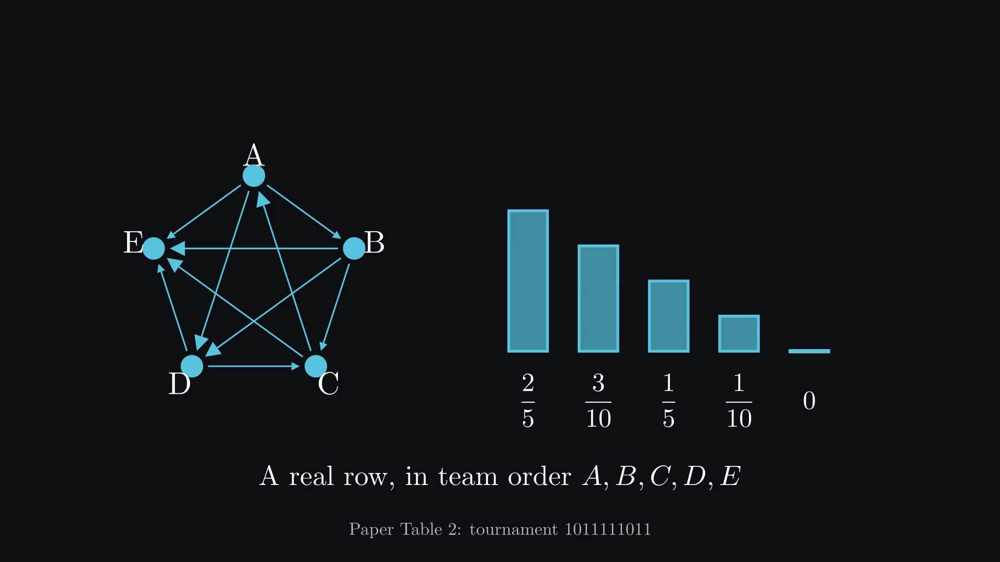</a>

**New-result candidate** · Social choice / Tournament rules

A tournament rule picks a champion from round-robin results. How much can up to three teams gain by fixing the matches among themselves? For five to eight teams, the best rules that always crown an unbeaten team cap that gain at exactly 2/5.

- **Result.** Optimal coalition gain 2/5 for five through eight teams, with exact monotone top-cycle-consistent rules.
- **Boundary.** Finite cases only; the all-size question remains open and lower bounds are prior work.
- **Paper:** [PDF](public-release/papers/three-team-manipulation-exact.pdf) · [LaTeX](economics/social-choice/tournament-rules/three-team-manipulation-exact/paper.tex)
- **Video:** [MP4](economics/social-choice/tournament-rules/three-team-manipulation-exact/video/video.mp4) · [Subtitles](economics/social-choice/tournament-rules/three-team-manipulation-exact/video/subtitles.srt) · [Script and QA](economics/social-choice/tournament-rules/three-team-manipulation-exact/video/README.md)
- **Checks:** [Verification](economics/social-choice/tournament-rules/three-team-manipulation-exact/verification/README.md) · [Review state](economics/social-choice/tournament-rules/three-team-manipulation-exact/readiness.md)
- **Formal:** No Lean formalization; the evidence is the written proof and the exact checks.
- **Package:** [economics/social-choice/tournament-rules/three-team-manipulation-exact](economics/social-choice/tournament-rules/three-team-manipulation-exact/)
