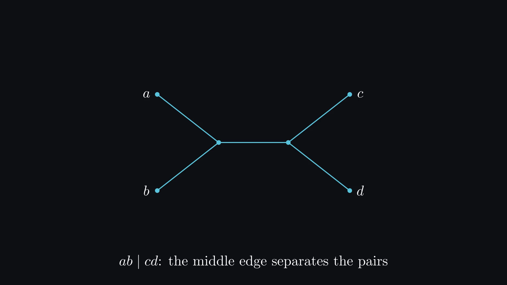
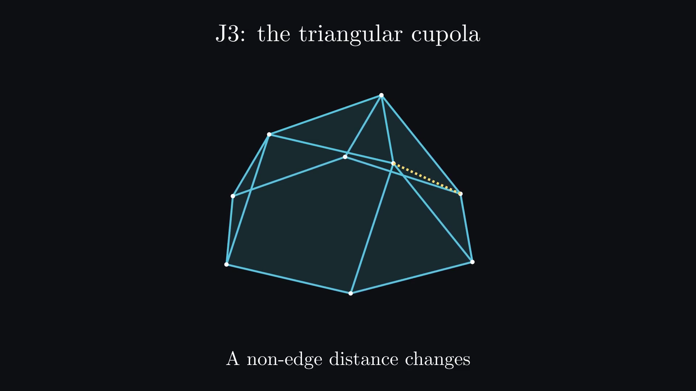
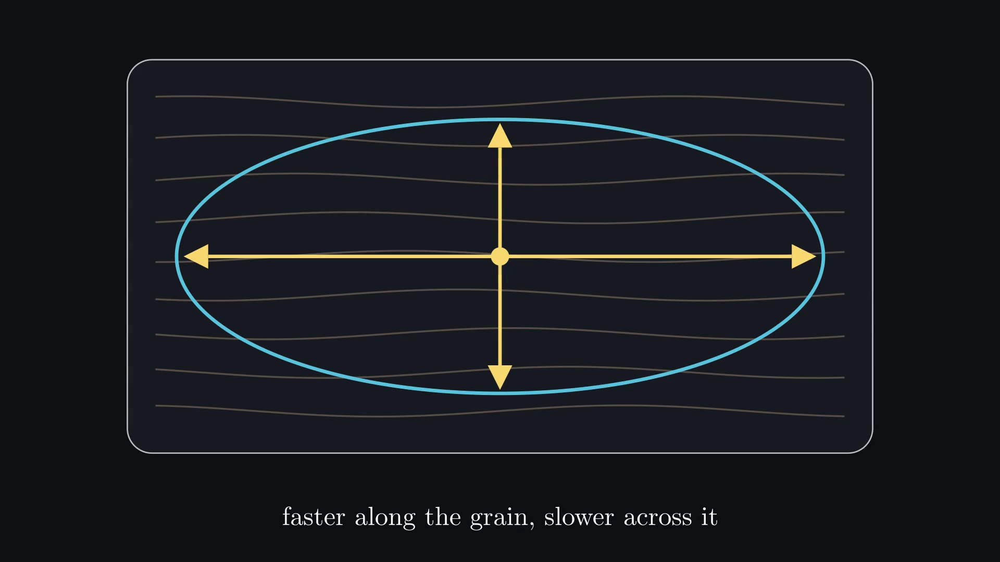
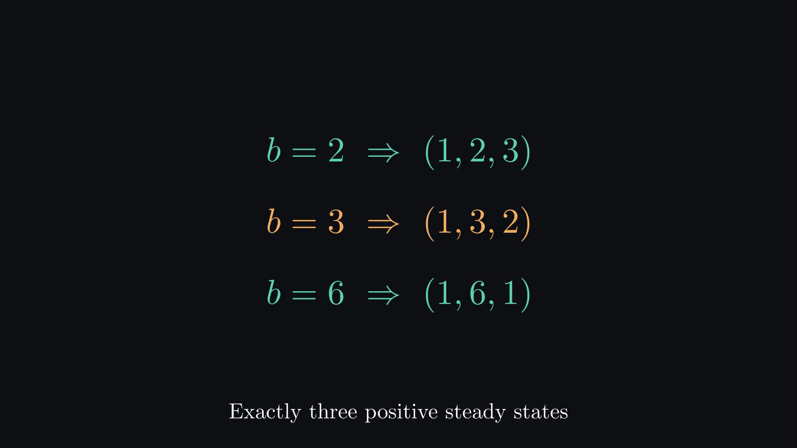

<p align="center">
  
</p>

# Valyu Research

Open problems in mathematics and science, worked through by coding agents with Valyu DeepResearch, Search and Contents. Each finding comes with a paper, a narrated video and the checks behind it.

**26 papers · 26 narrated videos · 4 fields**<br>
[Mathematics](FINDINGS.md#mathematics) 18 · [Physics](FINDINGS.md#physics) 5 · [Chemistry](FINDINGS.md#chemistry) 2 · [Economics](FINDINGS.md#economics) 1

### [Browse all 26 findings](FINDINGS.md)

Every entry gives a plain-language summary, the result, its boundary, the paper, the video, the checks and any formal proof.

> [!IMPORTANT]
> **Research drafts, not externally peer reviewed.** The author has not yet completed a line-by-line review of every proof. Reviews were internal; each package records its checks and limitations.
>
> The collection contains **23 new-result candidates**, one new proof of a known theorem and two independent verifications. Priority remains bounded by the literature searches. Lean covers the full Hales-Jewett theorem and supporting statements in six other findings; see [formal coverage](#formal-proofs).

## Featured results

### Common quartets in evolutionary trees

<a href="maths/combinatorics/phylogenetics/common-quartet-number/video/video.mp4"></a>

**Mathematics** · New-result candidate

Evolutionary trees can be compared by how they arrange every group of four species. Any three binary trees on 14 species must arrange some group of four identically, and 13 species are not enough.

- **Result.** h(3) = 14. For any number of trees, the general upper bound drops from a tower of four exponentials to a single exponential with base (1 + √13)/2, about 2.303. Also 23 ≤ h(4) ≤ 28.
- **Scope.** Lean checks only the sharp potential inequality, not the tree theorem. Optimality of the bound and the exact value of h(4) remain open.

[Paper (PDF)](public-release/papers/common-quartet-number.pdf) · [Video (MP4)](maths/combinatorics/phylogenetics/common-quartet-number/video/video.mp4) · [Details](FINDINGS.md#common-quartets-in-evolutionary-trees)

### Rigidity of the 92 Johnson solids

<a href="maths/geometry/rigidity/johnson-solids/video/video.mp4"></a>

**Mathematics** · New-result candidate

The Johnson solids are the 92 convex solids with regular polygon faces that are not Platonic, Archimedean, prisms or antiprisms. If every edge keeps its length and every face stays flat, which of them can still flex?

- **Result.** A complete classification: 47 are locally rigid and 45 flex, including exact treatment of six cases that first-order analysis cannot decide.
- **Scope.** Local rigidity in this model only, not rigidity of the bare edge graph or global uniqueness. A complete classification, not a new general rigidity theorem. No Lean formalization.

[Paper (PDF)](public-release/papers/johnson-solids.pdf) · [Video (MP4)](maths/geometry/rigidity/johnson-solids/video/video.mp4) · [Details](FINDINGS.md#rigidity-of-the-92-johnson-solids)

### Recovering a material's stiffness from its wave speeds

<a href="physics/mechanics/elasticity/generic-stiffness-recovery/video/video.mp4"></a>

**Physics** · New-result candidate

Can the full stiffness of an anisotropic material be recovered from how fast waves travel through it? For generic materials, yes: wave speeds in eleven generic directions determine all 21 density-normalized stiffness parameters.

- **Result.** A computer-assisted proof of generic three-dimensional recovery, resolving Conjecture E of de Hoop, Ilmavirta, Lassas and Várilly-Alvarado. Seven or fewer directions cannot suffice.
- **Scope.** Identifiability only: no guarantee of stable inversion from noisy measurements. "Generic directions" does not mean every set of eleven works, and eight to ten directions are unresolved. Comparison with the full text of Aristégui and Baste (1997) is still incomplete, so originality remains qualified. Lean checks supporting matrix lemmas and determinant identities, not the geometric theorem.

[Paper (PDF)](public-release/papers/generic-stiffness-recovery.pdf) · [Video (MP4)](physics/mechanics/elasticity/generic-stiffness-recovery/video/video.mp4) · [Details](FINDINGS.md#generic-three-dimensional-stiffness-recovery)

### Chemical robustness with multiple stable states

<a href="chemistry/reaction-networks/mass-action/acr-multistability-bounds/video/video.mp4"></a>

**Chemistry** · New-result candidate

A reaction network can have several stable states while one species has exactly the same concentration at every positive steady state. How small can a network with both properties be?

- **Result.** For reactions involving at most two molecules on each side, the minimum stoichiometric dimension is three and the minimum number of complexes is six. Three species already suffice.
- **Scope.** These are mathematical mass-action models, not experimental demonstrations. The minimum number of reactions remains open. Lean checks examples and robustness, not stability or the general lower bounds.

[Paper (PDF)](public-release/papers/acr-multistability-bounds.pdf) · [Video (MP4)](chemistry/reaction-networks/mass-action/acr-multistability-bounds/video/video.mp4) · [Details](FINDINGS.md#chemical-robustness-with-multiple-stable-states)

**[See all 26 findings](FINDINGS.md)**, including qudit error-correcting codes, a thermodynamic counterexample, tournament manipulation and a fully formalized Hales-Jewett theorem.

The [significance assessment](docs/significance.md) gives the editorial case for each result and its confidence levels; the [review ledger](docs/review-ledger.md) records the reviews behind it.

## Check the work

```bash
python3 tools/catalog.py check     # links, required files and release hashes (Python standard library only)
```

Each finding's folder has a `verification/` directory with its checkers, certificates and recorded results, and a README that says what they need. Some checks need Lean, SymPy, a C compiler or a TeX installation. The [reproduction guide](docs/reproduce.md) covers proofs, checkers, papers and videos.

### Formal proofs

The shared Lean library in [`formal/`](formal/) contains **153 audited declarations: 96 named theorems and 57 generated helpers.** All pass an axiom audit that allows only `propext`, `Classical.choice` and `Quot.sound`, and an independent replay by six proof checkers in Linux CI (26 October 2026).

That covers the library, not the papers as a whole:

| Coverage | Findings |
|---|---|
| Complete main theorem in Lean | Hales-Jewett |
| Supporting lemmas or examples only | Common quartets, elasticity, chemical robustness, cubic tic-tac-toe, restart, Lotka-Volterra |
| No Lean formalization | The other 19, including Johnson solids and the truncated dodecahedron |

Formal checking establishes the encoded statements, not the bibliography, publication priority or claims outside them. [Formal coverage](docs/formal-coverage.md) lists each theorem, what it proves and the CI records.

## How the work was done

Harvey Yorke directed the project. Coding agents developed the constructions, arguments, verification checkers and manuscript drafts. Literature, priority and adversarial reviews used Valyu DeepResearch, Search and Contents; these reviews are internal, not external peer review. Checkers and proofs were replayed locally, and the Lean library also in CI. Reports were read critically: useful attribution concerns were adopted and incorrect corrections were rejected with counterexamples. [Research provenance](docs/research-provenance.md) records the division of work.

Video narration is synthesized speech. The videos have technical checks; a listening review has not been performed.

Valyu develops the research tools used in this project.

## Layout

```text
FINDINGS.md          All findings (generated)
maths/ physics/ chemistry/ economics/
  <field>/<topic>/<finding>/
    README.md        Claim, status, prior work and how to reproduce it
    paper.tex        Editable manuscript and references.bib
    video/           Narrated explainer: video.mp4, subtitles, poster, source and QA
    verification/    Checkers, certificates and recorded results
public-release/      Paper PDFs linked above, release records, third-party notes
formal/              Shared Lean library and proof-replay scripts
docs/                Collection index, reviews, provenance and verification records
catalog/             Plain-language summaries and formal links for the gallery
tools/               Gallery, export, paper and video tooling
explorations/        Earlier leads, kept separate from the findings
```

The [documentation index](docs/README.md) lists everything else.

## Contribute

Pick a problem. Bring an agent. **[Build with Valyu](https://docs.valyu.ai/)** or **[contribute a finding](CONTRIBUTING.md)**.

## Rights and reuse

Code and Lean proofs are licensed under **Apache-2.0**. Papers, documentation and media are licensed under **CC BY 4.0**, with the third-party exceptions described in [LICENSE](LICENSE).

Third-party material retains its own terms. [NOTICE](NOTICE) and the [third-party inventory](public-release/THIRD_PARTY.md) identify the sources and exceptions, including the share-alike Heesch coordinates and associated visual adaptations. Attribution does not imply endorsement. Cite the individual paper when discussing a result, or use [CITATION.cff](CITATION.cff) for the collection.
