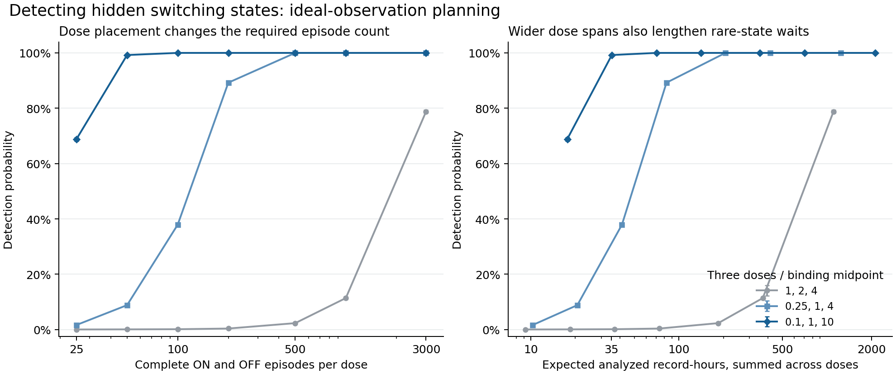

# How much can switching measurements reveal?

Exploratory research, 18 October 2026. **Checked mathematical results and
synthetic experimental design. No new genetic mechanism or biological
discovery is claimed.**

A binary gene readout can hide several molecular states. This investigation
asks which concentration-dependent measurements rule out the simplest hidden
models, and how to choose those measurements efficiently.

## What survived checking

Under nonnegative affine concentration-dependent rates, a model with at most
three states must have a singleton ON or OFF state. That side's inverse mean
dwell time must be `A+B*c`, with `A,B>=0`. Three well-chosen concentrations can
rule out both possibilities. Two cannot do so from the particular mean curves
studied here: an explicit reversible three-state model fits any two samples.

For the equilibrium example, the optimal triple at fixed concentration span
`r^2` is `(1/r,1,r)`, in units of the binding midpoint. Its sharp tolerance to
relative target-mean error is `(r-1)^2/(r^2+6r+1)`. This is a deterministic
design objective, not a proof of optimal statistical power or recording time.

A finite-sample implementation controls false positives at 5% under its null
and acquisition assumptions. In ideal-observation simulations, doses
`(0.1,1,10)` with 50 complete ON and 50 complete OFF episodes per dose detect
the four-state example in 99.23% of 20,000 experiments. At an illustrative
1.5-minute switching time, these episodes total an expected 35.25 recording
hours, excluding initial segments and overhead.



## What the source audit changed

The original four-state construction is **exactly a known two-site symmetric
exclusion process with a reservoir**. We withdrew architectural novelty after
matching its generator to the published model. Its invariant switching time
also extends to larger equilibrium exclusion networks.

The relevant gene-regulation paper proves an exclusion within a different,
restricted topology. This example does not refute that theorem. Published
Drosophila data also involve transcription inference and temporal filtering,
so applying the ideal complete-dwell test directly would be unjustified.

Correctness confidence is high for the checked arguments. Originality of the
specific state-counting and dose-design consequences remains unknown. A
realistic observation-model comparison and a closer priority review are
required before a submission claim.

## Evidence and reproduction

- [Model, exact identities and scope](bio-chem/EQUILIBRIUM_SWITCHING_LEAD.md).
- [Independent proof and sharp dose design](switching-audit-20261018/AUDIT.md):
  36 exact symbolic checks.
- [Finite-sample test, power and acquisition assumptions](switching-experiment-20261018/README.md).
- [Independent numerical review](switching-audit-20261018/experiment-audit.json):
  500 linear-program comparisons and three direct CTMC simulations.
- [Primary-source and observation audit](switching-prior-audit-20261018/AUDIT.md).
- [Real-data detector reproduction](switching-prior-audit-20261018/forward-check/):
  217 traces, 1,000 initiation-posterior samples each; maximum ON-probability
  discrepancy `6.8834e-15`. The original Bayesian deconvolution was not rerun.

Run from this directory with SymPy 1.14.0, NumPy 2.3.3, SciPy 1.16.3 and
Matplotlib available:

```bash
python3 bio-chem/check_equilibrium_switching.py
python3 switching-audit-20261018/check_switching_audit.py
python3 switching-experiment-20261018/check_design_power.py
python3 switching-audit-20261018/check_experiment_audit.py
python3 switching-experiment-20261018/plot_design_power.py
```

These are executable algebraic and numerical checks, not a complete Lean
formalization. Synthetic record counts and effects must not be described as
measurements from cells.

## Research provenance

Valyu Search and Contents located and compared primary papers and public data.
The ongoing max DeepResearch review is task
`DR-064`. The local proof, dose design and statistical
test were developed and independently reviewed while it was queued. Its
pending follow-up brief was corrected with the established exclusion-model
prior and new results before delivery. A queued review is not a completed
endorsement. Full search results, task receipts and observation code remain
in the unpublished working record; third-party full texts and service credentials
are not redistributed here.
